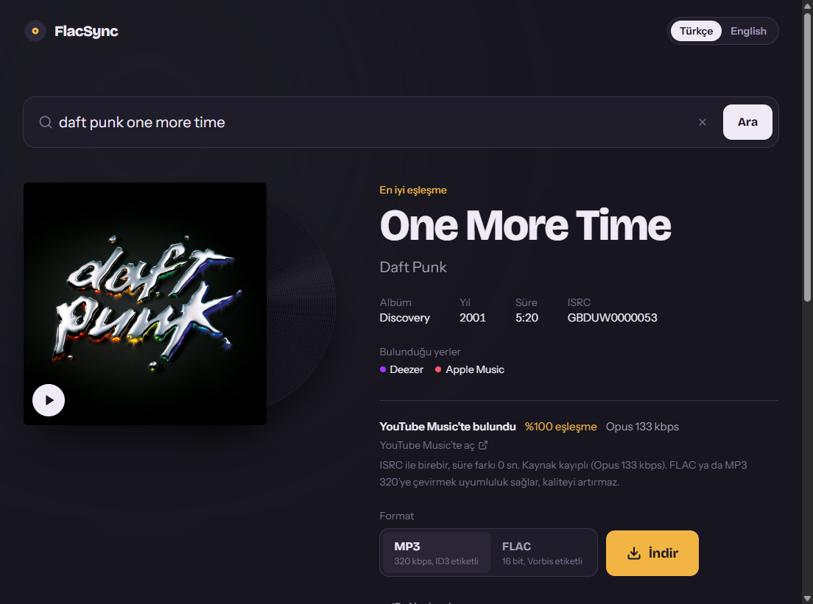
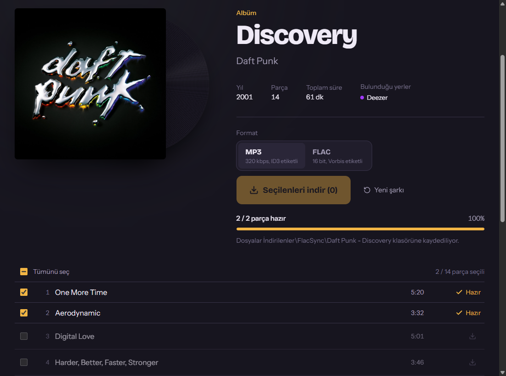

# FlacSync

Spotify, Apple Music, Deezer ve YouTube Music linklerinden — ya da sadece şarkı adından — doğru
kaydı bulan, kapağı ve etiketleriyle **MP3** veya **FLAC** olarak kaydeden açık kaynak masaüstü
uygulaması. Tek şarkı, albüm ve çalma listesi destekler.

*[English below](#english)*



## Özellikler

- **Şarkı adıyla arama** — Deezer, Apple Music ve (anahtar varsa) Spotify'da paralel arar, aynı
  kaydı birleştirir, en iyi sonucu otomatik seçer. Live / remix / karaoke sürümleri sen yazmadıkça
  geri plana atılır.
- **Link desteği** — Spotify, Apple Music, Deezer, YouTube Music şarkı, albüm ve çalma listesi
  linkleri; kısa linkler (`spotify.link`, `link.deezer.com`) dahil. **Amazon Music** albüm linkleri
  MusicBrainz üzerinden aynı albüme çevrilir; şarkı linkleri için Odesli API anahtarı gerekir.
- **Albümler** — Albüm ya da sanatçı adını ara (ör. "daft punk discovery") veya bir şarkıdayken
  **Albümü aç**'a bas; albümün tüm parçaları listelenir.
- **Toplu indirme** — Albümün tamamını, seçtiğin parçaları ya da tek bir parçayı indir. Albüm
  dosyalarına parça numarası (`03/14`), albüm sanatçısı, yıl ve kapak ortak yazılır; masaüstünde
  `İndirilenler\FlacSync\Sanatçı - Albüm\` klasörüne kaydedilir.
- **Doğru eşleşme** — Önce ISRC ile birebir, sonra başlık + sanatçı + süre (±5 sn) ile YouTube
  Music'te aynı kayıt bulunur; cover, live, sped-up vb. sürümler elenir.
- **Etiketler** — MP3: ID3v2 (başlık, sanatçı, albüm, yıl, tür, ISRC, parça no, kapak).
  FLAC: Vorbis comment + gömülü kapak.
- **Zaman damgalı şarkı sözleri** — [LRCLib](https://lrclib.net)'ten bulunan LRC sözleri dosyaya gömülür
  (FLAC: `LYRICS`, MP3: USLT + SYLT); oynatıcıda sözler şarkıyla birlikte akar.
- **Oynatıcı** — Önceki / sonraki, karıştır, tekrar (tümü / tek), ilerleme çubuğu, kulağa göre ayarlı
  ses seviyesi, klavye ve medya tuşları. Albüm, keşfet ve arama sonuçlarında 30 sn önizleme; kütüphanede
  tam şarkı.
- **Keşfet** — Türe ve ülkeye göre en çok dinlenen şarkılar ve albümler.
- **Kütüphane** — İndirdiğin şarkılar: arama, tür filtresi, albüm görünümü, tek tıkla çal / karıştır.
- **Sanatçı profilleri** — Sanatçı adına tıkla: popüler şarkılar, diskografi, benzer sanatçılar.
- **Doğru türler** — Tür iTunes ve MusicBrainz'den belirlenir (Deezer'ın her şeye "Pop" demesi yerine);
  Kütüphane'de **Türleri düzelt** eski dosyaları da düzeltir, tür tıklanıp elle de değiştirilebilir.
- **Çalma listeleri** — Kendi listelerin + akıllı listeler (en çok dinlenenler, son eklenenler, hiç
  dinlenmeyenler); M3U8 olarak dışa aktar (VLC, foobar2000, MusicBee, telefon).
- **Sanatçı takibi** — Takip ettiğin sanatçıların yeni albüm ve single'ları ana sayfada.
- **Şimdi çalıyor ekranı** — Büyük kapak, dönen plak, akan sözler, sıradakiler; **uyku zamanlayıcı**.
- **Ayarlar** — 6 renk teması ve renkten bağımsız 6 tasarım (Klasik, Yumuşak, Sıkı, Keskin, Kaset, Cam),
  dil, varsayılan format ve ses.
- **Uygulama içi güncelleme** — Yeni sürüm çıkınca uygulama haber verir; tek tıkla indirip kurar
  (portable sürüm kendini değiştirir).
- **Ana sayfa ve geçmiş** — İstatistikler, şu an inenler ve uygulama kapanınca da duran
  "Son indirilenler" listesi.
- **İndirme sırası** — Tüm indirmeler tek yerde: albüm / seçime göre gruplu, iptal, yeniden dene,
  süre ve codec bilgisi. Arama sonuçlarından tek tıkla ya da çoklu seçimle sıraya ekle.
- **Hızlı** — Aynı anda 4 indirme; eşleştirmede alınan bilgi indirmede yeniden kullanılır
  (1.1.0'a göre tek şarkı ~%45, albüm ~2 kat daha hızlı).
- **6 dil** — Türkçe, English, Deutsch, Español, Français, Русский.



### Ses kalitesi hakkında dürüst not

Ses YouTube Music'ten alınır ve **kayıplıdır** (çoğunlukla Opus ~130 kbps; YouTube Premium çerezleri
ile AAC 256 kbps). FLAC veya MP3 320'ye dönüştürmek dosyayı uyumlu hale getirir ama **kaliteyi
artırmaz**. Uygulama kaynağın gerçek codec ve bitrate'ini her zaman gösterir ve dosyanın yorum
etiketine yazar.

FlacSync DRM'li akışları (Spotify, Apple Music, Deezer) **indirmez veya çözmez**; bu platformları
yalnızca şarkı bilgisi (metadata) için kullanır.

## Kurulum

[Releases](../../releases) sayfasından indir:

- **`FlacSync-Setup-x.y.z.exe`** — Kurulum sihirbazı (Başlat menüsü + masaüstü kısayolu,
  Ayarlar → Uygulamalar'dan kaldırılabilir). Yönetici izni gerekmez.
- **`FlacSync-x.y.z.exe`** — Kurulumsuz (portable) sürüm; çift tıkla çalışır.

### "Windows bilgisayarınızı korudu" uyarısı

Dosyalar henüz **kod imzalı değil**; Windows SmartScreen bu yüzden "Bilinmeyen yayımcı" der.
Uyarıyı geçmek için **Ek bilgi → Yine de çalıştır**. Dosyanın değişmediğini sürümdeki
`SHA256SUMS.txt` ile doğrulayabilirsin:

```powershell
Get-FileHash .\FlacSync-Setup-1.1.0.exe -Algorithm SHA256
```

Sürüm dosyaları yalnızca bu depodan, GitHub Actions üzerinde derlenir. İmzalama planı ve politikası:
[CODE_SIGNING.md](CODE_SIGNING.md).

Dosyalar [VirusTotal'de temiz](CODE_SIGNING.md#virustotal-taraması) (1.3.0 kurulum: 0/65).

### Ayarlar ve API anahtarları (isteğe bağlı)

Uygulama anahtarsız çalışır. Spotify'da arama ve Spotify linklerinde ISRC / doğru albüm adı için
menüden **Dosya → Ayarlar ve API anahtarları** ile [Spotify Developer](https://developer.spotify.com/dashboard)
anahtarlarını ekleyip **Dosya → Yeniden başlat** de. Menü çubuğu **Alt** tuşuyla görünür.

YouTube bir değişiklik yaptığında indirmeler bozulursa: **Araçlar → yt-dlp'yi güncelle**.

## Kod imzalama politikası / Code signing policy

Windows sürümleri için ücretsiz kod imzalama [SignPath.io](https://about.signpath.io) tarafından,
sertifika ise [SignPath Foundation](https://signpath.org) tarafından sağlanmaktadır
(başvuru sürecinde; onaylanana kadar dosyalar imzasızdır).

*Free code signing provided by [SignPath.io](https://about.signpath.io), certificate by
[SignPath Foundation](https://signpath.org)* (application pending; releases are unsigned until approved).

- **Yazarlar ve inceleyiciler / Committers and reviewers:** [furkibayashi](https://github.com/furkibayashi)
- **Onaylayıcılar / Approvers:** [furkibayashi](https://github.com/furkibayashi)
- Yalnızca bu depodaki koddan GitHub Actions ile derlenen dosyalar imzalanır. Ayrıntılar:
  [CODE_SIGNING.md](CODE_SIGNING.md). / Only files built from this repository by GitHub Actions are signed.

**Gizlilik / Privacy:** Bu program, kullanıcı tarafından açıkça istenmedikçe herhangi bir ağ sistemine
bilgi aktarmaz. / This program will not transfer any information to other networked systems unless
specifically requested by the user or the person installing or operating it.

## Geliştirme

Gereksinimler: **Node.js 20+**, Windows (masaüstü paketi için). Python gerekmez.

```bash
npm install --ignore-scripts
npm run setup:binaries     # yt-dlp, ffmpeg, esbuild ve Electron ikililerini indirir
```

| Komut | Ne yapar |
|---|---|
| `npm run dev` | API (`:4000`) + arayüz (`:5173`) geliştirme sunucuları |
| `npm run desktop:dev` | Masaüstü uygulamasını geliştirme modunda açar |
| `npm run desktop:dist` | `desktop/release/` altına kurulum + portable exe üretir |
| `npm test` | Birim testleri |
| `npm run typecheck` | Tüm paketlerde TypeScript kontrolü |

Backend ortam değişkenleri için [`backend/.env.example`](backend/.env.example) dosyasına bakın.

### Proje yapısı

```
backend/    Express + TypeScript API
  src/services/metadata/   Platform sağlayıcıları (Spotify, Apple Music, Deezer, YouTube Music)
  src/services/resolver/   Ses kaynağı eşleştirme (ISRC / başlık+sanatçı+süre)
  src/services/search/     Çoklu platform arama ve sıralama
  src/services/downloader  yt-dlp indirme, ffmpeg dönüştürme, ID3/Vorbis etiketleme
  src/services/jobs        İndirme kuyruğu, toplu işler, ZIP
frontend/   React + Tailwind CSS arayüz (TR / EN)
desktop/    Electron kabuğu ve Windows paketleme (electron-builder)
```

### REST API

| Uç nokta | Açıklama |
|---|---|
| `POST /api/search` `{query}` | Şarkı adıyla tüm platformlarda arama |
| `POST /api/lookup` `{url}` | Link → şarkı metadata'sı veya albüm / çalma listesi parçaları |
| `POST /api/resolve` `{url}` | Şarkı için eşleşen ses kaynağı |
| `POST /api/download` `{url, format}` | Tek şarkı indirme işi (ilerleme: `GET /api/download/:id/events`, SSE) |
| `GET /api/download?url=&format=` | Tek istekte indir, etiketlenmiş dosyayı döndür |
| `POST /api/batch` `{name, format, items}` | Toplu indirme (ilerleme: `/api/batch/:id/events`, ZIP: `/api/batch/:id/zip`) |
| `GET /api/discover?genre=&country=` | Türe / ülkeye göre popüler şarkılar ve albümler |
| `GET /api/artist/find?name=` · `GET /api/artist/:id` | Sanatçı arama ve profil (popüler şarkılar, albümler, benzerler) |
| `GET /api/lyrics?title=&artist=&album=&duration=` | LRCLib'den zaman damgalı sözler |
| `GET /api/library` · `POST /api/library/rescan` | Kütüphane listesi / klasörü yeniden tara |
| `GET /api/library/tracks/:id/stream` | Kütüphanedeki dosyayı çal (Range destekli) |
| `GET`/`POST /api/library/tracks/:id/lyrics` | Dosyadaki sözler / sözleri bulup dosyaya göm |

## Katkı

Katkılar memnuniyetle karşılanır — [CONTRIBUTING.md](CONTRIBUTING.md).

## Sorumlu kullanım

Bu yazılım yalnızca dinleme ve kopyalama hakkına sahip olduğunuz içerikler için kullanılmalıdır.
İndirdiğiniz içeriklerin telif haklarına ve ilgili platformların kullanım koşullarına uymak
kullanıcının sorumluluğundadır.

## Lisans

[MIT](LICENSE) © 2026 FlacSync contributors. Paketle gelen FFmpeg (GPL-3.0), yt-dlp (Unlicense) ve
Electron'un lisansları için [THIRD_PARTY_NOTICES.md](THIRD_PARTY_NOTICES.md).

---

## English

**FlacSync** is an open-source desktop app that finds the right recording from a Spotify, Apple
Music, Deezer or YouTube Music link — or just a song name — and saves it as a tagged **MP3** or
**FLAC** with cover art. Single songs, albums and playlists are supported.

- **Search by name** across Deezer, Apple Music and (with API keys) Spotify; results are merged and
  the best match is picked automatically.
- **Bulk downloads** for albums and playlists: download everything, a selection, or one track. Album
  files get track numbers, album artist, year and cover.
- **Accurate matching** on YouTube Music by ISRC first, then title + artist + duration (±5 s).
- **Honest quality**: audio comes from YouTube Music and is lossy (usually Opus ~130 kbps).
  Converting to FLAC/320 kbps MP3 improves compatibility, not quality. FlacSync never downloads or
  decrypts DRM-protected streams.
- **Player, Discover, Library and artist profiles**, synced LRC lyrics embedded into the files, six
  themes, in-app updates, and Amazon Music album links.
- **Six languages**: Turkish, English, German, Spanish, French, Russian.

Download the installer (`FlacSync-Setup-x.y.z.exe`) or the portable exe from [Releases](../../releases).
For development: `npm install --ignore-scripts && npm run setup:binaries`, then `npm run dev` or
`npm run desktop:dev`. See the tables above for commands and API endpoints.

Use it only for content you have the right to download. Licensed under [MIT](LICENSE); bundled
third-party programs are listed in [THIRD_PARTY_NOTICES.md](THIRD_PARTY_NOTICES.md).
